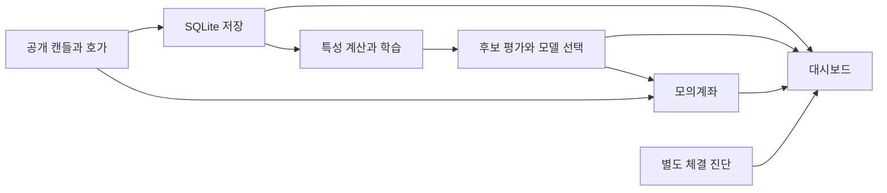

<div align="center">

# 📈 업비트 5종목 모의투자 연구

### 공개 시세 · XGBoost · 현물 모의체결 · 대시보드

공개 캔들과 호가를 수집하고, 학습한 모델을 별도의 모의계좌에서 관찰합니다.<br>
수집·연구·모의체결·운영 상태를 연결한 데이터 분석 시스템입니다.


[빠른 시작](#quick-start) · [저장소 구성](#repository-structure) · [실험 설정](#data-settings)

</div>

---

<a name="introduction"></a>

## ✨ 프로젝트 소개

BTC·SOL·ETH·XRP·DOGE의 공개 시세를 사용해 데이터 수집, GPU 학습, 시점별 평가와 모의체결을 수행하는 연구 코드입니다. `engine.py`는 `PAPER_ONLY = True`로 구성되며 실계좌 주문과 연구 결과를 구분합니다.

| 기능 | 구현 내용 |
| :--- | :--- |
| 시세 수집 | 완료된 캔들 수집과 과거 이력 탐색 |
| 모델 연구 | XGBoost 학습·후보 비교·평가 구간 관리 |
| 모의체결 | 공개 호가 잔량·수수료·슬리피지를 반영한 현물 모의계좌 |
| 상태 화면 | 수집·모델·계좌·진단 결과 표시 |
| 운영 감독 | 프로젝트 프로세스와 작업 상태 관리 |
| 진단 | 데이터 무결성, 계좌 조건, 별도 체결 경로 확인 |



<a name="repository-structure"></a>

## 📁 저장소 구성

```text
.
├── engine.py
├── dashboard.py
├── supervisor.py
├── execution_probe.py
├── healthcheck.py
├── 운영.ps1
├── requirements.txt
├── tools/
├── tests/
├── web/
├── upbit_auto_trader_v5.ipynb
└── docs/VERSIONS.md
```

- [연구·모의투자 엔진](engine.py), [대시보드](dashboard.py), [감독 프로세스](supervisor.py).
- [체결 진단](execution_probe.py)과 [운영 상태 검사](healthcheck.py).
- [검사 코드](tests/)와 [버전 기록](docs/VERSIONS.md).

<a name="implementation"></a>

## 🧩 주요 기술과 실행 경계

NumPy·pandas로 데이터를 구성하고 XGBoost를 학습합니다. 운영 데이터는 SQLite와 JSON으로 기록합니다. `collector`, `trainer`, `paper`, `experiment`, `check-gpu`가 엔진의 명령 진입점입니다.

`execution_probe.py`는 별도 계좌에서 매수·매도 경로를 검사합니다. 이 결과를 전략 계좌의 거래나 수익과 합치지 않습니다. `healthcheck.py`는 계좌·데이터·장치 근거의 조건을 확인하며, 그 통과가 투자 성능을 의미하지 않습니다.

<a name="quick-start"></a>

## 🚀 빠른 시작

소스 확인용 Python 환경을 준비하고 명령 구성을 확인합니다.

```powershell
python -m venv .venv
.\.venv\Scripts\python -m pip install -r requirements.txt
.\.venv\Scripts\python engine.py --help
```

실제 운영에는 자신에게 맞는 `engine-config.json`, `service.json`, 실행 경로와 데이터 저장 환경이 필요합니다. 두 설정 파일과 운영 DB·모델·계좌 장부는 이 공개 사본에 포함되어 있지 않습니다.

기존 `운영.ps1`과 Docker 제어 도구는 원래 프로젝트 경로·컨테이너·마운트를 검사합니다. 다른 컴퓨터에서 그대로 실행 가능한 설치 프로그램으로 취급하지 말고 설정과 경로 계약을 먼저 읽으세요. 활성 SQLite를 Windows와 Linux에서 동시에 열지 않도록 실행 환경을 일관되게 유지해야 합니다.

<a name="data-settings"></a>

## 📊 데이터 구성과 실험 설정

| 항목 | 코드의 구성 |
| :--- | :--- |
| 종목 | KRW-BTC, KRW-SOL, KRW-ETH, KRW-XRP, KRW-DOGE |
| 시간봉 | 1·3·5·10·15·30·60·240분과 일봉 |
| 기본봉 | 5분 |
| 기본 의존성 | NumPy, pandas, XGBoost 3.0.5 |
| 수집 자료 | 공개 캔들·호가 |
| 저장 자료 | 캔들 DB, 모델 명세, 실험 결과, 모의계좌 기록 |

시간순 학습·평가 구간과 잠금 시험 구간을 구분해야 합니다. 정확도만 보지 않고 클래스 분포·다수 클래스 기준·Macro F1·Balanced accuracy·비용 반영 모의손익을 함께 검토하는 구조입니다. 수익률과 거래 횟수는 실제 결과 파일 없이 미리 제시하지 않습니다.

<a name="troubleshooting"></a>

## 🛠️ 문제 해결

| 증상 | 확인할 내용 |
| :--- | :--- |
| 설정 파일 오류 | 공개 사본에 없는 실행 설정을 준비했는지 확인 |
| Docker 경로 검사가 실패함 | 기존 컨테이너 이름·마운트·프로젝트 경로 계약 |
| SQLite 오류 | 동일 환경의 단일 소유 원칙과 DB/WAL 일관성 |
| GPU 학습을 시작하지 못함 | XGBoost·GPU 드라이버와 장치 확인 결과 |
| 거래가 발생하지 않음 | 모델 준비·신호·비용·진입 조건·진단 기록 |
| 체결 진단 수익이 다름 | 별도 진단 계좌와 전략 계좌의 결과를 구분 |

---

<div align="center">

**데이터와 모델, 모의체결의 근거를 따로 기록합니다.**

</div>
