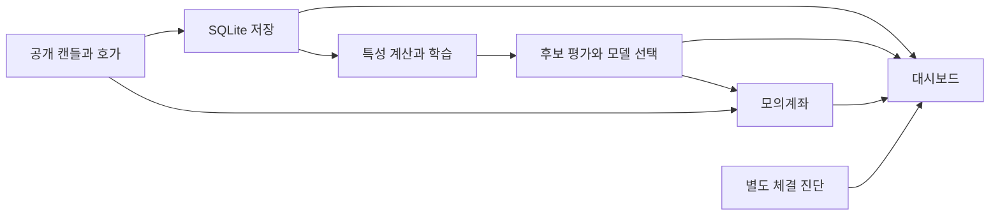

<a name="-upbit-paper-trading-project"></a>
# Upbit Paper Trading Project

11차 후속 코드·검증 보완은 [Windows 원자 저장 안내](11차/Windows_원자저장_보완.md)에서 확인하며, 원래 실험 결과와 전체 비교 원문은 보존합니다.

<!-- project-levels:start -->
## 읽는 수준 선택

| 수준 · 이 안내에서 읽을 내용 |
| --- |
| **수준:** [LEVEL 1 - Beginner](docs/읽기안내/레벨1.md)<br>**이 안내에서 읽을 내용:** 낯선 용어를 풀어 쓰며 실제 동작·예시·오해하기 쉬운 범위를 읽습니다. |
| **수준:** [LEVEL 2 - Explorer](docs/읽기안내/레벨2.md)<br>**이 안내에서 읽을 내용:** 입력·처리·출력과 기능 사이의 연결, 차수 변화를 따라갑니다. |
| **수준:** [LEVEL 3 - Practitioner](docs/읽기안내/레벨3.md)<br>**이 안내에서 읽을 내용:** 준비 조건·사용 순서·설정·결과 및 실패 확인 방법을 읽습니다. |
| **수준:** [LEVEL 4 - Advanced](docs/읽기안내/레벨4.md)<br>**이 안내에서 읽을 내용:** 모듈 설계·상태 전이·검증 경계와 구현 선택을 검토합니다. |
| **수준:** [LEVEL 5 - Expert](docs/읽기안내/레벨5.md)<br>**이 안내에서 읽을 내용:** 실제 코드·프로토콜·설정값·전체 비교와 측정 근거를 대조합니다. |

모든 안내는 같은 프로젝트와 전체 차수를 다룹니다. 기존 상세 본문은 아래에 계속 보존합니다.
<!-- project-levels:end -->


<a name="-11차-timesfm-사전학습-모델의-zero-shot-비교"></a>
## 11차 TimesFM 사전학습 모델의 Zero-Shot 비교

**PC 전용 zero-shot GPU 실험 10회 완료 후 중지** 상태입니다. 원래 계획의 7회와 잔여 2회, 자료 부족에 따른 대체 1회로 구성되며, 원래 10개 anchor를 모두 완료한 것은 아닙니다. 추가 학습은 0회이며 자동 반복 일시정지, 11차 STOP, 기존 6차 pause와 7·8차 STOP, 5코인 모의매매를 유지합니다. 최종 검증과 원격 반영은 별도 영수증으로 관리합니다.

TimesFM2.5 200M의 처리 창은 56,320개(시장 56,300개와 재로드 probe 20개), validation 방향 표본은 28,150개이며 가중 방향 일치율은 49.136767%입니다.

cash 7회와 plain 3회 중 기본 비용 거래 3회는 모두 손실이어서 후보를 채택하거나 가상투자에 적용하지 않았습니다. 방향 일치율은 60분 종가 변화 방향에 대한 값이며 승률이나 3클래스 정확도가 아닙니다.

[회차별결과](11차/README.md) · [집계](11차/실험결과.json) · [보완계획](11차/실행보완계획.json) · [변경기록](11차/변경기록.md) · [전체비교](11차/전체비교.md). 후향 평가, 사전학습 노출 미확인, 지평 중첩, 실호가와 비용의 한계를 유지합니다. 회차 수익을 합산하지 않으며 수익, 정확도 100%, 낙폭 10% 이내를 보장하지 않습니다.

고정 가중치의 문맥512·예측12봉, 2일 정책 선정과 2일 후속 평가, 동일 진입 기회·비용1배/2배, 저장·재로드·중단 조건을 [11차 코드별 상세 안내](11차/README.md)에 정리했습니다.

회차 경과시간 합833.041977초와 전체 벽시계1,003.807609초를 구분합니다. 이번 안내 정리에서 모델·앱·실험을 다시 실행하지 않았습니다.

<a name="-10차-비용-차감-수익-연구와-거래-장부-진단"></a>
## 10차 비용 차감 수익 연구와 거래 장부 진단

실제 CUDA 적합 30회와 저장·재로드 검증을 완료했지만, 신규 후보는 거래 수와 순수익 기준 미달로 채택하지 않았습니다. 두 fold의 후속 평가는 현금 정책으로 0거래·0수익이며, 기존 모델 비교는 학습 노출이 있는 후향 진단입니다. 업비트 완료 OHLCV 9시간봉 연구이며 외부 50GB 전체 학습, 수익 개선, 자동 승격을 주장하지 않습니다. [10차 결과](10차/README.md) · [실험 집계](10차/실험결과.json) · [변경 기록](10차/변경기록.md) · [전체 비교](10차/전체비교.md). 최종 검증과 원격 반영은 별도 영수증으로 관리하며 GPU 성과와 구분합니다. 수익·정확도100%·낙폭10% 이내를 보장하지 않으며 기존 자동 학습 중지와 모의계좌는 보존합니다.

## ⏸️ 9차 학습 중지와 거래 모델 재정비

자동 학습을 중지하고 기존 모의매매·시세 수집을 유지합니다. 학습 손실 감소와 튜닝 손실 증가를 구분하고, 거래 비용·시간순 검증·단순 기준선 비교를 우선하는 방향을 정리합니다. 새 적합이나 수익 개선을 주장하지 않습니다. [9차 설명](9차/README.md) · [변경 기록](9차/변경기록.md) · [직전 8차 이후 전체 비교](9차/전체비교.md). 아래 연속 학습 설명은 중지 요청 이전의 역사적 정책입니다.

<a name="-8차-가중치-연속-추가학습"></a>
## 8차 가중치 연속 추가학습

기존 Chronos-2 체크포인트를 이어 50스텝씩 10회 추가 학습합니다. 고정 학습·튜닝 자료를 재사용하며 새 독립 평가와 수익 검증은 수행하지 않습니다. 모델 적용과 원시 자료 삭제도 하지 않습니다. [8차 설명](8차/README.md) · [변경 기록](8차/변경기록.md) · [직전 7차 이후 전체 비교](8차/전체비교.md).

<a name="-7차-사전학습-시계열-연구"></a>
## 7차 사전학습 시계열 연구

공개 Chronos-2의 지식을 이어 추가 학습하는 독립 연구 트랙과 월요일 PBL 승인 디자인 기반의 실제 3D 대시보드입니다. 기존 5코인 현물 가상계좌와 운용 모델을 보존합니다. 연구 체크포인트 준비는 매매 승격이나 수익 개선 증거가 아닙니다. [7차 설명](7차/README.md) · [변경 기록](7차/변경기록.md) · [직전 6차 이후 전체 비교](7차/전체비교.md).

<a name="-6차-연속-데이터-연구"></a>
## 6차 연속 데이터 연구

초기50GB 연구 이후 새 고유 자료2GB 단위의 수집·GPU학습·검증을 자동 연결합니다. 학습 중에도 수집을 유한 선행하고 기존 모델의 업비트 현물 모의매매를 유지합니다. 중립 편향·신호 부족은 별도 실험으로 관측하며 검증 미달 모델은 적용하지 않습니다. [6차 설명](6차/README.md) · [변경 기록](6차/변경기록.md) · [직전 5차 이후 전체 비교](6차/전체비교.md).

아래 4차 요청 대기 정책은 6차 연속 모드가 대체하며 기본 수동 모드는 계속 지원합니다.

<a name="-5차-월-경계-누락-복구"></a>
## 5차 월 경계 누락 복구

50GB 적재 뒤에도 부족했던 최근 분봉을 기존 기준 그대로 보완해 초기 연구를 재개했습니다. 월 경계·UTC·중복·완료 날짜를 검사하며, 학습과 모의매매는 별도 트랙으로 유지합니다. 준비 검사 통과와 연구 시작은 모델 성적이나 수익 개선을 뜻하지 않습니다. [5차 설명](5차/README.md) · [변경 기록](5차/변경기록.md) · [직전 4차 이후 전체 비교](https://github.com/PUVKID/Upbit-Paper-Trading-Project/compare/stage-4-20261102...stage-5-20261102) · [공개 통합 전체 비교](5차/전체비교.md)

<a name="-4차-두-트랙-연구와-복구"></a>
## 4차 두 트랙 연구와 복구

기존 자료·모델·모의계좌를 보존한 채 수집·학습 대기·현물 모의매매 서비스를 다시 연결합니다. 연구는 최초50GB→GPU학습1회→요청대기, 이후 명시 요청마다 새 자료2GB→학습1회이며 모의매매와 추론용 최신 시세 갱신은 별도로 계속됩니다. 이전 자동 재학습 정책을 대체합니다. [4차 실행 설명](4차/README.md) · [파일별 변경](4차/변경기록.md) · [전체 차수](docs/REVISION_INDEX.md)

| 차수·자료 · 자료 폴더·원본 · 상세 설명 · 직전 비교·범위 |
| --- |
| **차수·자료:** 로컬 1차·2차 보존<br>**자료 폴더·원본:** [확인 범위](docs/versions/)<br>**상세 설명:** [원본 보존과 공개 제외](docs/versions/local-history.md)<br>**직전 비교·범위:** [세부 비교 미확인 근거](docs/versions/local-history.md) |
| **차수·자료:** 기존 공개 기본<br>**자료 폴더·원본:** [자료 폴더](docs/materials/001-stage-1) · [원본 파일](engine.py)<br>**상세 설명:** [상세 설명](docs/materials/001-stage-1/README.md)<br>**직전 비교·범위:** [전체 비교·범위](docs/versions/stage-1.md) |
| **차수·자료:** 2차 조건 문서<br>**자료 폴더·원본:** [자료 폴더](docs)<br>**상세 설명:** [상세 설명](docs/2%EC%B0%A8_%EC%A4%91%EB%A6%BD%EC%9B%90%EC%9D%B8_%EC%97%B0%EC%86%8D%ED%95%99%EC%8A%B5.md)<br>**직전 비교·범위:** [전체 비교·범위](docs/2%EC%B0%A8_%EC%A4%91%EB%A6%BD%EC%9B%90%EC%9D%B8_%EC%97%B0%EC%86%8D%ED%95%99%EC%8A%B5.md) |
| **차수·자료:** GPU 처리량 개선<br>**자료 폴더·원본:** [자료 폴더](%ED%9B%84%EC%86%8D%EB%B3%B4%EC%A1%B4/2026-10-30_GPU%EC%B2%98%EB%A6%AC%EB%9F%89)<br>**상세 설명:** [상세 설명](docs/versions/gpu-throughput-20261030.md)<br>**직전 비교·범위:** [전체 비교·범위](docs/revision-audit/GPU%EC%B2%98%EB%A6%AC%EB%9F%89.md) |
| **차수·자료:** 3차 초기 부분 보존<br>**자료 폴더·원본:** [자료 폴더](%ED%9B%84%EC%86%8D%EB%B3%B4%EC%A1%B4/2026-10-30_133824_3%EC%B0%A8%EC%B4%88%EA%B8%B0%EB%B6%80%EB%B6%84)<br>**상세 설명:** [상세 설명](docs/versions/3%EC%B0%A8-%EC%B4%88%EA%B8%B0%EB%B6%80%EB%B6%84.md)<br>**직전 비교·범위:** [전체 비교·범위](docs/revision-audit/3%EC%B0%A8.md) |
| **차수·자료:** 3차<br>**자료 폴더·원본:** [자료 폴더](3%EC%B0%A8)<br>**상세 설명:** [상세 설명](docs/versions/3%EC%B0%A8.md)<br>**직전 비교·범위:** [전체 비교·범위](docs/revision-audit/3%EC%B0%A8-%EC%9B%90%EA%B2%A9%EB%B3%80%EA%B2%BD.md) |
| **차수·자료:** 4차<br>**자료 폴더·원본:** [자료 폴더](4%EC%B0%A8)<br>**상세 설명:** [상세 설명](docs/versions/4%EC%B0%A8.md)<br>**직전 비교·범위:** [전체 비교·범위](docs/revision-audit/3-to-4.md) |
| **차수·자료:** 5차<br>**자료 폴더·원본:** [자료 폴더](5%EC%B0%A8)<br>**상세 설명:** [상세 설명](docs/versions/5%EC%B0%A8.md)<br>**직전 비교·범위:** [전체 비교·범위](docs/revision-audit/4-to-5.md) |
| **차수·자료:** 6차<br>**자료 폴더·원본:** [자료 폴더](6%EC%B0%A8)<br>**상세 설명:** [상세 설명](6%EC%B0%A8/README.md)<br>**직전 비교·범위:** [전체 비교·범위](6%EC%B0%A8/%EC%A0%84%EC%B2%B4%EB%B9%84%EA%B5%90.md) |
| **차수·자료:** 7차<br>**자료 폴더·원본:** [자료 폴더](7%EC%B0%A8)<br>**상세 설명:** [상세 설명](7%EC%B0%A8/README.md)<br>**직전 비교·범위:** [전체 비교·범위](7%EC%B0%A8/%EC%A0%84%EC%B2%B4%EB%B9%84%EA%B5%90.md) |
| **차수·자료:** 8차<br>**자료 폴더·원본:** [자료 폴더](8%EC%B0%A8)<br>**상세 설명:** [상세 설명](8%EC%B0%A8/README.md)<br>**직전 비교·범위:** [전체 비교·범위](8%EC%B0%A8/%EC%A0%84%EC%B2%B4%EB%B9%84%EA%B5%90.md) |
| **차수·자료:** 9차<br>**자료 폴더·원본:** [자료 폴더](9%EC%B0%A8)<br>**상세 설명:** [상세 설명](9%EC%B0%A8/README.md)<br>**직전 비교·범위:** [전체 비교·범위](9%EC%B0%A8/%EC%A0%84%EC%B2%B4%EB%B9%84%EA%B5%90.md) |
| **차수·자료:** 10차<br>**자료 폴더·원본:** [자료 폴더](10%EC%B0%A8)<br>**상세 설명:** [상세 설명](10%EC%B0%A8/README.md)<br>**직전 비교·범위:** [전체 비교·범위](10%EC%B0%A8/%EC%A0%84%EC%B2%B4%EB%B9%84%EA%B5%90.md) |
| **차수·자료:** 11차<br>**자료 폴더·원본:** [자료 폴더](11차/)<br>**상세 설명:** [GPU10회 완료·fit0·미채택](11차/README.md)<br>**직전 비교·범위:** [전체 비교·범위](11차/전체비교.md) |

최종본으로 지정된 차수는 없습니다. 4차 복구 시점의 관측을 현재 수집량·신규 모델 성적이나 수익 검증 완료로 해석하지 않습니다.

## 이전 3차 변경 기록

아래 자동 재학습 조건은 위 4차 계약으로 대체된 이전 기록입니다.

### 3차 외부50GB 초기학습

[3차 실행 설명](3차/README.md) · [파일별 변경과 전체 비교](3차/변경기록.md) · [저장·준비 계약](3차/docs/요구사항_및_데이터계약.md)

외부 고유아카이브50GB의 다운로드·SHA256검증·스트리밍집계를 마친 뒤GPU학습을 시작하고, 이후업비트에서 요청당200개씩완성봉을누적하며재학습합니다. 기존검증모델의현물모의매매는계속유지합니다. 초기50GB준비중이며확보완료·새모델성적·정확도100%·수익달성을주장하지않습니다.

| 확인된 차수 · 보존과 공개 범위 · 안내 |
| --- |
| **확인된 차수:** 1차·2차<br>**보존과 공개 범위:** 로컬보존대응표에서존재확인. 개인운영자료포함압축원본은공개제외, 세부차이비교미확인<br>**안내:** [확인범위와한계](3차/변경기록.md) |
| **확인된 차수:** 기존 공개 기본·GPU개선<br>**보존과 공개 범위:** 기존공개Git이력에보존<br>**안내:** [GPU개선설명](docs/versions/gpu-throughput-20261030.md) |
| **확인된 차수:** 3차<br>**보존과 공개 범위:** 외부수집·특징·초기학습gate·설정·검사·운영설명<br>**안내:** [3차폴더](3차/) · [변경기록](3차/변경기록.md) |

| 확인된 차수·위치 · 내용 · 설명·비교 |
| --- |
| **확인된 차수·위치:** 기존 공개 기본<br>**내용:** 시세 수집·GPU 연구·현물 모의체결<br>**설명·비교:** [기존 기록](docs/versions/stage-1.md) · [보존 기준](https://github.com/PUVKID/Upbit-Paper-Trading-Project/tree/5d365eeff59b0d6d81607b336f14d238303c57a0) |
| **확인된 차수·위치:** 2026-10-30 GPU 처리량 개선<br>**내용:** 인덱스 정렬·행렬 재사용·1시장 선행 준비·단계 시간<br>**설명·비교:** [설명](docs/versions/gpu-throughput-20261030.md) · [전체 코드 비교](docs/versions/gpu-throughput-20261030-engine-diff.md) · [회귀 검사](tests/test_gpu_throughput.py) |

기존 차수 번호가 확인되지 않아 임의 번호를 붙이지 않았습니다. 이번 변경은 학습 처리량 개선이며 GPU100%상시 사용·정확도95%·수익 향상을 달성했다는 뜻이 아닙니다. [실측과 제약](docs/2026-10-30_GPU처리량_개선.md)을 함께 확인하십시오.

XGBoost 예측과 모의체결·대시보드를 연결한 가상자산 모의투자 도구입니다.

**기술 분류:** 시계열 머신러닝 › 트리 앙상블 › XGBoost·확률 보정·모의체결

`Python`
`XGBoost`
`SQLite`
`모의투자`

[빠른 시작](#quick-start) · [저장소 구성](#repository-structure) · [실험 설정](#data-settings)

[핵심 구성](#input-processing-output)

<a name="implementation-details"></a>

<a name="-독립-트랙과-연구-상태의-연결"></a>
## 독립 트랙과 연구 상태의 연결

루트 engine.py와 설정은 공개 시세 수집·연구·모의매매를 연결하고,3차 external_data.py는 공식 외부 아카이브의 검증·고유 저장·최근 자료 준비를,4차 research_control.py는 요청별 연구 상태를 관리합니다.5차는 월 경계 수집 계획 보완,6차는 후속 연구,7차는 Chronos-2 별도 연구,8차는 고정 자료 반복 적합,9차는 자동 학습 중지와 검증 계획입니다.

초기 외부 고유50,000,000,000바이트를 준비한 뒤 연구 한 회차를 수행하고 완료 뒤 명시 요청을 기다리는 것이4차 계약입니다. 추가 요청은 당시 실제 고유 적재량+2,000,000,000바이트로 목표를 동결합니다. 압축해제·DB·복제 크기로 채우지 않으며 초기 미완료·중복 요청을 거부합니다. 모의매매와 최신 시세 갱신은 별도 트랙으로 기존 검증 모델과 장부를 사용합니다.

ResearchControl은 collecting→training→completed와 batch·claim·attempt를 JSON에 보존합니다. 상태 잠금과 학습 잠금을 분리하고 완료 보고서·모델/manifest 해시를 요청과 결합합니다. 모델 실패는 원문과 시도 수를 남기며, 정상 결과 저장 뒤 상태 기록만 중단됐다면 완료 결과를 검증해 남은 처리를 복구합니다. 학습 완료와 promote 여부를 따로 기록합니다.

5차의 대기는 단순50GB 부족이 아니라 최근14일98% 커버리지 미달이 원인이었습니다. bootstrap_plan은 직전 월별 자료와 이번 달·최근14일 완료 UTC 날짜의 일별 원본을 중복 없이 최근 순으로 요청합니다.2026-11-02 준비 표시가 참으로 바뀐 관측은 GPU 적합 완료·수익 향상과 다릅니다.

7차 Chronos-2는 RTX4090 CUDA에서40,998행·context192·batch8·50step의 추가 학습과 저장/재로드를 기록했습니다. 후속20창 상대MAE0.210743%는 종가 유지0.204550%보다 나빴고 방향 일치율20%는 거래 승률이 아닙니다.8차는 같은 train/tune으로50step fit10회이며 학습 손실4.521545→3.839211, 튜닝 손실7.453165→8.106275를 기록했습니다. 새 독립평가는 없고 candidate_ready/promote=false입니다.

9차는 work/service/TRAINING_PAUSED와7·8차 STOP 경계로 새 적합을 중지합니다. 과거 실행 안내를 현재 자동 재개 명령으로 사용하지 않습니다. 기존 체크포인트·시세·모의계좌를 보존하며 후속 연구는 비용·시점 분리·미사용 평가·승격 계약을 정한 뒤 명시 재개해야 합니다. 이 중지는 임의 Python 전체를 막는 운영체제 보안 기능은 아닙니다.

<a name="-10차-비용-차감-수익-연구와-거래-장부-진단-1"></a>
### 10차: 비용 차감 수익 연구와 거래 장부 진단

10차는 평균·q10·q90 수익 모델을 2개 시간 구간과 5개 시장에 적합하고 현금·추세·기존 모델과 비교합니다. 보존된 집계에는 CUDA 적합 30회와 모델 재로딩 검증이 기록되어 있지만 신규 정책은 후속 평가에서 거래 0회로 미채택입니다. 외부 50GB 기초학습·독립 최종 시험·자동 승격은 이 실행의 결과가 아닙니다. [함수·설정·기간·저장·관측 상세](10차/README.md)와 [집계 JSON](10차/실험결과.json)에서 정책 선정 구간과 후속 평가를 구분해 읽을 수 있습니다.

현재 기본 엔진의 `Portfolio`는 `max_drawdown=0.1`을 신규 매수 차단에 연결합니다. `drawdown_limit`은 bool·비유한 값과 0~1 열린 구간 밖의 값을 거부하고 복원 시 고점·MDD·차단 상태를 검증합니다. `observe_drawdown`은 차단 시각을 유지하며 날짜 변경·모델 교체로 이를 해제하지 않습니다. 손절·익절·만료·매도 처리는 유지되므로 10% 손실 상한을 보장하는 장치는 아닙니다.

`Portfolio.process`의 `clean_context`는 진입 근거와 현재 청산 판단을 분리하며 기존 `invalid`·`partial_invalid`를 보존합니다. 잘못된 진입 근거는 `entry_context_invalid=true`, `entry_model_run=null`로 기록합니다. 호가 기록은 원호가·관측 시각·나이·위험 평가 가격 출처·수수료·슬리피지를 담습니다. 과거 누락 정보를 현재 모델의 판단으로 채우지 않습니다.

`10차/trade_diagnostics.py`는 매수 수수료를 포함한 평균원가를 매도 수량 비율로 배분하고 부분 매도·추가 진입·미청산 잔량·현금·실현손익을 대조합니다. 불완전 장부는 `incomplete`, 잘못된 체결 자료는 `rejected`로 분리합니다. 기본 입력은 `work/paper/state.json`, 출력은 `10차/work/trade-diagnostics.json`이며 최대 32MiB의 안정된 스냅샷을 읽고 원자 교체로 출력합니다. 과거 누적 계좌 진단을 10차 신규 모델의 수익으로 합산하지 않습니다.

`dashboard.py`의 `return_research`는 `10차/work/status.json`에서 schema 1, 허용 상태·단계, 적합 수 0~30, 구간 수 1~2, 목적과 승격 금지를 검사합니다. 완료 상태는 적합 수가 계획과 같고 평가가 수행되었을 때만 표시합니다. 비교 행은 최대 60개 중 유효한 후보·비용·유한 수익·MDD·거래 수만 전달하며 파일 경로와 오류 원문은 제외합니다. `cuda:0`도 GPU 확인 표시가 함께 있을 때만 전달합니다. 화면은 10차 수익 연구를 8차 반복 추가학습 및 현재 모의계좌와 구분해 완료 모델 수·구간·미채택·운용 미적용을 보여 줍니다. 계좌 화면의 낙폭 한도 비율과 매수 차단 여부는 장부의 유효한 수치·bool에서 읽습니다.

[각 차수의 코드·조건·관측·전체 비교](docs/REVISION_INDEX.md)


<a name="overview"></a>

<a name="-주요-개발-내용"></a>
## 주요 개발 내용

시세 수집·연구 결과와 호가 기반 모의체결을 연결하는 코드 묶음입니다.

공개 코드의 모의계좌와 실제 주문은 구분합니다.

- PAPER_ONLY 설정으로 모의계좌의 체결과 손익을 기록합니다.
- 엔진의 함수 단위로 시세 처리와 모의 거래 상태 갱신을 추적할 수 있습니다. 연구 모델과 화면은 별도 구성요소입니다.

**자료별 안내:** [기본](docs/versions/stage-1.md) · [전체 기록](docs/VERSIONS.md)

<a name="preview"></a>

<a name="input-processing-output"></a>

<a name="-입력처리출력"></a>
## 입력·처리·출력

**단계:** 입력

**이 프로젝트에서 다루는 내용:** 공개 캔들·호가

**단계:** 처리

**이 프로젝트에서 다루는 내용:** 시계열 특성·구간 분리, XGBoost·보정·모델 선택

**단계:** 출력

**이 프로젝트에서 다루는 내용:** 모의계좌·평가·대시보드


---

<a name="introduction"></a>

<a name="-프로젝트-소개"></a>
## 프로젝트 소개

공개 시세로 전략을 살펴보고 모의계좌에서 체결 과정을 확인하는 연구 프로젝트입니다.

BTC·SOL·ETH·XRP·DOGE의 공개 시세를 사용해 데이터 수집, GPU 학습, 시점별 평가와 모의체결을 수행하는 연구 코드입니다. `engine.py`는 `PAPER_ONLY = True`로 구성되며 실계좌 주문과 연구 결과를 구분합니다.

**기능:** 시세 수집

**구현 내용:** 완료봉만 저장하고 기존 봉을 덮어쓰지 않는 SQLite 수집, 요청 간격 공유

**기능:** 모델 연구

**구현 내용:** 시간순 분할·CUDA XGBoost·앙상블 가중치·확률 보정·후보 승격

**기능:** 모의체결

**구현 내용:** 호가 단계별 부분체결·미체결금액·수수료·슬리피지와 보유 한도

**기능:** 상태 화면

**구현 내용:** 수집·모델·계좌·진단 결과 표시

**기능:** 운영 감독

**구현 내용:** 프로젝트 프로세스와 작업 상태 관리

**기능:** 진단

**구현 내용:** 데이터 무결성, 계좌 조건, 별도 체결 경로 확인




<a name="repository-structure"></a>

<a name="-저장소-구성"></a>
## 저장소 구성

```text
.
├── engine.py
├── dashboard.py
├── supervisor.py
├── execution_probe.py
├── healthcheck.py
├── 운영.ps1
├── requirements.txt
├── tools/
├── tests/
├── web/
├── upbit_auto_trader_v5.ipynb
└── docs/VERSIONS.md
```

- [연구·모의투자 엔진](engine.py), [대시보드](dashboard.py), [감독 프로세스](supervisor.py).
- [체결 진단](execution_probe.py)과 [운영 상태 검사](healthcheck.py).
- [검사 코드](tests/)와 [버전 기록](docs/VERSIONS.md).

<a name="implementation"></a>

<a name="-주요-기술과-실행-경계"></a>
## 주요 기술과 실행 경계

분석에 쓸 데이터는 NumPy·pandas로 구성하고 XGBoost를 학습합니다. 운영 데이터는 SQLite와 JSON으로 기록합니다. `collector`, `trainer`, `paper`, `experiment`, `check-gpu`가 엔진의 명령 진입점입니다.

`execution_probe.py`는 별도의 2,500만 원 진단 계좌에서 BTC 매수·매도 경로를 검사합니다. 전략 계좌의 기본 1,000만 원과 구분하며, 진단의 최대 배정 비율은 0.1%입니다. 이 결과를 전략 계좌의 거래나 수익과 합치지 않습니다. `healthcheck.py`는 계좌·데이터·장치 근거의 조건을 확인하며, 그 통과가 투자 성능을 의미하지 않습니다.

<a name="-완료봉에서-매매-신호까지"></a>
### 완료봉에서 매매 신호까지

수집기는 공개 캔들과 호가의 GET 요청만 허용합니다. 완료되지 않은 봉은 저장하지 않고, 같은 종목·시간봉·시각의 기존 봉은 `INSERT OR IGNORE`로 보존합니다. 누락된 시각에 가짜 봉을 채우지 않습니다.

특성은 수익률, 변동성, 이동평균, 거래량, 봉의 몸통과 범위 등으로 구성합니다. 여러 시간봉은 과거 방향의 `merge_asof`로 결합합니다. 라벨은 다음 봉 시가에서 진입해 지정한 미래 시각의 종가로 계산하며, 결측봉이 있어도 단순 행 이동으로 다른 시각을 대신하지 않습니다.

### ⏱️ 시간 구간과 모델 승격

학습 → 가중치 조정 → 확률 보정 → 거래규칙 선택 → 후보 검증 → 최종 시험을 구분합니다. 학습과 평가 경계에는 예측 기간을 고려한 간격을 두며, 최종 시험 구간은 노출 예약을 먼저 기록해 같은 구간의 반복 사용을 막습니다. 예약 후 실패한 시도도 사용 이력에서 지우지 않습니다.

앙상블 가중치는 조정 구간에서, 온도 보정은 별도 보정 구간에서 정합니다. 거래규칙에는 거래하지 않는 후보도 있습니다. 후보 승격은 같은 검증 구간에서 로그 손실과 `순수익 - 0.5 × 최대 낙폭`을 비교하며, 라벨 구성이 다른 경우에는 거래 지표 비교로 구분합니다. 단순히 새 학습이 끝났다는 이유로 운영 모델을 교체하지 않습니다.

<a name="-모의계좌의-주문-조건"></a>
### 모의계좌의 주문 조건

모의체결은 호가의 가격과 잔량을 순서대로 소비합니다. 잔량이 부족하면 부분체결과 미체결금액을 남기며, 수수료·슬리피지를 반영합니다. 과거 평가에서는 다음 봉 시가를 사용하고, 현재 모의계좌에서는 추론 후 새로 가져온 호가를 사용합니다.

오래된 특징, 미래 시각, 중복 처리 봉은 신규 매수를 막습니다. 일일 손실 한도에 도달해도 기존 포지션 청산 경로는 유지하며, 현금·종목별·전체 배정 한도를 함께 적용합니다. 거래 이력과 계좌 상태는 SQLite 거래 단위로 기록합니다.

<a name="-보존한-v4-실험과-현재-엔진"></a>
### 보존한 v4 실험과 현재 엔진

[이전 v4 노트북](보존자료/원본/upbit_auto_trader_v4.ipynb)은 4코인·초기 100만 원·5분봉에 15분/1시간 피처를 결합하고, LightGBM·XGBoost·GRU·LSTM·Transformer를 비교하던 별도 실험입니다. 첫 Markdown의 1시간봉·1.5% 설명과 실제 설정인 5분봉·0.6%가 다릅니다. 현재 5코인 엔진에서는 구간 분리·승격·모의체결 조건을 별도로 구성했습니다.

v4에는 `signal_confidence(self, prob)` 정의와 두 호출부의 `(prob, ticker)` 인자가 맞지 않는 부분이 남아 있습니다. 상위 시간봉 피처의 단순 전방 채움, 예측 기간을 비워 두지 않은 분할 경계, Walk-Forward 평가 구간을 LightGBM 조기 종료에 사용한 점도 평가 해석의 제약입니다. 해당 보존 노트북의 전체 실행 성공이나 완전히 독립적인 시험 성능을 보증하지 않습니다.

<a name="-대시보드의-표시-범위"></a>
### 대시보드의 표시 범위

대시보드는 저장된 계좌·학습·진단 자료를 GET 요청으로 읽습니다. 3D 막대는 과거 평가의 예측 표본 개수이며 현재 매매 확률이나 실시간 주문 신호가 아닙니다. WebGL을 사용할 수 없으면 2D 표시로 전환하고, 자료가 없으면 대기 상태를 표시합니다. 화면 모션 정지는 수집·학습·모의체결 프로세스를 중단하지 않습니다.

저장된 기록과 코드의 기본값을 바탕으로 모의거래 흐름을 설명합니다.

<a name="quick-start"></a>

<a name="-빠른-시작"></a>
## 빠른 시작

소스 확인용 Python 환경을 준비하고 명령 구성을 확인합니다.

```powershell
python -m venv .venv
.\.venv\Scripts\python -m pip install -r requirements.txt
.\.venv\Scripts\python engine.py --help
```

실제 운영에는 자신에게 맞는 `engine-config.json`, `service.json`, 실행 경로와 데이터 저장 환경이 필요합니다. 공개 사본에는 모의 전용 설정 파일이 포함돼 있으며 실행 경로와 자원 조건을 확인해야 합니다. 운영 DB·학습 모델·계좌 장부는 포함하지 않습니다.

기존 `운영.ps1`과 Docker 제어 도구는 원래 프로젝트 경로·컨테이너·마운트를 검사합니다. 다른 컴퓨터에서 그대로 실행 가능한 설치 프로그램으로 취급하지 말고 설정과 경로 계약을 먼저 읽으세요. 활성 SQLite를 Windows와 Linux에서 동시에 열지 않도록 실행 환경을 일관되게 유지해야 합니다.

<a name="data-settings"></a>

<a name="-데이터-구성과-실험-설정"></a>
## 데이터 구성과 실험 설정

**항목:** 종목

**코드의 구성:** KRW-BTC, KRW-SOL, KRW-ETH, KRW-XRP, KRW-DOGE

**항목:** 시간봉

**코드의 구성:** 1·3·5·10·15·30·60·240분과 일봉

**항목:** 기본봉

**코드의 구성:** 5분

**항목:** 기본 의존성

**코드의 구성:** NumPy, pandas, XGBoost 3.0.5

**항목:** 수집 자료

**코드의 구성:** 공개 캔들·호가

**항목:** 저장 자료

**코드의 구성:** 캔들 DB, 모델 명세, 실험 결과, 모의계좌 기록


아래 값은 `engine.py`의 기본값과 후보 탐색 구성입니다.

**항목:** 구간 길이

**기본값·후보:** 학습 180일, 조정 30일, 보정 30일, 규칙 2일, 검증 2일, 최종 시험 30일

**항목:** 예측 기간

**기본값·후보:** 기본봉 12개 또는 24개 뒤

**항목:** 라벨 임계 후보

**기본값·후보:** 0.6% 또는 0.3%, 체결 비용 반영

**항목:** XGBoost 깊이

**기본값·후보:** 3 또는 5

**항목:** 학습

**기본값·후보:** 최대 200라운드, 학습률 0.05, 조기 종료

**항목:** 기본 모의자산

**기본값·후보:** 10,000,000원

**항목:** 최대 배정

**기본값·후보:** 종목별 12.5%, 전체 50%

**항목:** 신규 매수 중단

**기본값·후보:** UTC 일 기준 손실 1.5%

**항목:** 포지션 조건

**기본값·후보:** 손절 2%, 익절 4%, 보유기간 종료

**항목:** 거래 비용

**기본값·후보:** 수수료 0.05% + 슬리피지 0.05%

**항목:** 최소 금액·호가 나이

**기본값·후보:** 5,000원, 10초


`check-gpu`는 무작위 자료의 짧은 학습으로 CUDA 경로를 검사합니다. 실제 연구 학습도 booster의 장치 설정을 확인하며, CUDA가 준비되지 않았을 때 CPU로 조용히 대체하지 않습니다. `healthcheck.py`의 준비중 상태는 학습 완료나 성능 통과와 다릅니다.

시간순 학습·평가 구간과 잠금 시험 구간을 나누고, 클래스 분포·다수 클래스 기준·Macro F1·Balanced accuracy·비용 반영 모의손익을 함께 검토합니다. 정확도 95%를 목표로 설정했으며, 실제 성능과 모의손익은 실행 결과 파일에 기록합니다.

<a name="troubleshooting"></a>

<a name="️-문제-해결"></a>
## 문제 해결

**증상:** 설정 파일 오류

**확인할 내용:** 포함된 모의 전용 설정의 경로·스키마·자원 조건을 확인

**증상:** Docker 경로 검사가 실패함

**확인할 내용:** 기존 컨테이너 이름·마운트·프로젝트 경로 계약

**증상:** SQLite 오류

**확인할 내용:** 동일 환경의 단일 소유 원칙과 DB/WAL 일관성

**증상:** GPU 학습을 시작하지 못함

**확인할 내용:** XGBoost·GPU 드라이버와 장치 확인 결과

**증상:** 거래가 발생하지 않음

**확인할 내용:** 거래하지 않기 후보, 신호 확률, 배정 한도, 오래된 특징·호가, 일일 손실 제한 확인

**증상:** 시험 구간 사용이 거부됨

**확인할 내용:** 최종 평가 예약·노출 기록과 보호 구간 확인; 기존 이력을 삭제해 재사용하지 않음

**증상:** 체결 진단 수익이 다름

**확인할 내용:** 별도 진단 계좌와 전략 계좌의 결과를 구분


---

<div align="center">

**데이터와 모델, 모의체결의 근거를 따로 기록합니다.**

</div>

<a name="️-현행과-초기-시점-보존"></a>
## 현행과 초기 시점 보존

2026-10-30 공개된 3차는 외부 50GB 자료 준비·특징 연결을 반영했습니다. 현재 공통 엔진과 수집기에는 4·5차 변경이 반영되어 있습니다. `3차/`는 공통 루트 엔진·설정·검사를 참조하는 모듈 보관 단위입니다. 초기 13:38 부분본은 [후속보존/2026-10-30_133824_3차초기부분](후속보존/2026-10-30_133824_3차초기부분/)에 원문 그대로 보존했습니다. 기존 `3차/연결부`와 `3차/검사`는 초기 수집본의 경로도 유지한 사본이며, 현행 엔진과 검사는 루트의 파일을 참조합니다.

<!-- apps-revision-audit -->

<a name="-모든-차수보관본과-전체-차이"></a>
## 모든 차수·보관본과 전체 차이

숫자·버전은 확인된 보관 자료명을 유지합니다. 비교 대상이 없거나 부분 소스인 경우 해당 설명에 표시했습니다.

| 차수·보관본 · 파일·폴더 · 설명 · 공개 파일 전체 비교 |
| --- |
| **차수·보관본:** 고유 작업 코드·문서<br>**파일·폴더:** [작업소스](보존자료/작업소스/)<br>**설명:** [원본 제품자료 목록](docs/SOURCE_MATERIALS.md)<br>**공개 파일 전체 비교:** 원래 경로·해시 유지 |
| **차수·보관본:** 2차 · 학습 조건 문서<br>**파일·폴더:** [원본 문서](docs/2차_중립원인_연속학습.md)<br>**설명:** 연속 학습·중립 원인·과거 계좌 조건<br>**공개 파일 전체 비교:** [제품자료 목록](docs/SOURCE_MATERIALS.md) |
| **차수·보관본:** 3차 · 외부자료 연결 당시<br>**파일·폴더:** [원격 7개 파일·공통 루트 참조](3차/)<br>**설명:** [구성·실제 비교](docs/versions/3차.md)<br>**공개 파일 전체 비교:** [초기 부분본 → 당시 3차](docs/revision-audit/3차.md) |
| **차수·보관본:** 3차 · 13:38 초기 부분 보존<br>**파일·폴더:** [6개 원본·안내](후속보존/2026-10-30_133824_3차초기부분/)<br>**설명:** [시점·파일 해시](docs/versions/3차-초기부분.md)<br>**공개 파일 전체 비교:** [당시 3차와 전체 차이](docs/revision-audit/3차.md) |
| **차수·보관본:** 공통 엔진·3차 연결 당시<br>**파일·폴더:** [루트 실행 입력](.)<br>**설명:** [3차 변경 기록](3차/변경기록.md)<br>**공개 파일 전체 비교:** [원격 GPU 기준 → 3차 전체 차이](docs/revision-audit/3차-원격변경.md) |
| **차수·보관본:** GPU처리량<br>**파일·폴더:** [44개](%ED%9B%84%EC%86%8D%EB%B3%B4%EC%A1%B4/2026-10-30_GPU%EC%B2%98%EB%A6%AC%EB%9F%89)<br>**설명:** [자료 범위](docs/revision-audit/GPU%EC%B2%98%EB%A6%AC%EB%9F%89.md)<br>**공개 파일 전체 비교:** [파일·주석·공백·해시](docs/revision-audit/GPU%EC%B2%98%EB%A6%AC%EB%9F%89.md) |

2차 문서는 학습 조건을 기록하고, GPU 개선은 날짜별 코드 스냅샷으로 보관합니다. 루트 실행본과 각 스냅샷을 비교합니다.


<a name="️-차수별-화면과-검증-이미지"></a>
### 차수별 화면과 검증 이미지

[원문 이미지·차수별 출처·파일 해시](docs/IMAGE_MATERIALS.md)에서 화면과 합성 테스트 입력을 확인할 수 있습니다.
