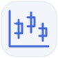
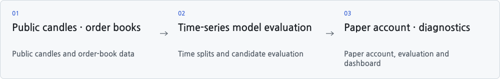
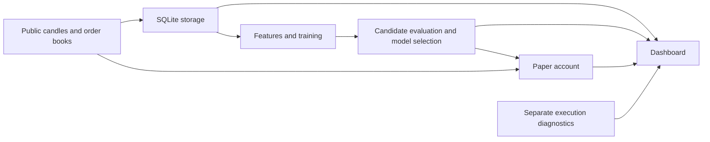

<a name="-upbit-paper-trading-project"></a>
<a id="upbit-paper-trading-project"></a>
<!-- readme-header32:start -->
<p align="center"></p>
<h1 align="center" id="project-title">Upbit Paper Trading Project</h1>
<p align="center">Time-series model evaluation and paper trading</p>
<p align="center">
  <a href="../README.md"></a>
  <a href="README.md"></a>
</p>
<p align="center">
  <a href="../docs/읽기안내/레벨1.md"></a>
  <a href="../docs/읽기안내/레벨2.md"></a>
  <a href="../docs/읽기안내/레벨3.md"></a>
  <a href="../docs/읽기안내/레벨4.md"></a>
  <a href="../docs/읽기안내/레벨5.md"></a>
</p>
<p align="center"><small>LEVEL links open the Korean source at the same reading level.</small></p>
<picture>
  <source media="(max-width: 600px) and (prefers-color-scheme: dark)" srcset="../assets/readme/flow-en-dark-mobile.svg" />
  <source media="(max-width: 600px)" srcset="../assets/readme/flow-en-light-mobile.svg" />
  <source media="(prefers-color-scheme: dark)" srcset="../assets/readme/flow-en-dark.svg" />
  <source media="(prefers-color-scheme: light)" srcset="../assets/readme/flow-en-light.svg" />
  
</picture>
<!-- readme-header32:end -->


See [Windows atomic-save improvements (Korean source)](../11차/Windows_원자저장_보완.md) for follow-up revision 11 code and verification improvements. Original experimental results and full-comparison originals are preserved.

<!-- project-levels:start -->
<a id="읽는-수준-선택"></a>
## Choose a reading level

| Level | What this guide covers |
| --- | --- |
| [LEVEL 1 - Beginner (Korean source)](../docs/읽기안내/레벨1.md) | Unfamiliar terms explained with actual behavior, examples, and easily misunderstood limits. |
| [LEVEL 2 - Explorer (Korean source)](../docs/읽기안내/레벨2.md) | Inputs, processing, outputs, feature connections, and revision changes. |
| [LEVEL 3 - Practitioner (Korean source)](../docs/읽기안내/레벨3.md) | Prerequisites, usage steps, settings, results, and checking failures. |
| [LEVEL 4 - Advanced (Korean source)](../docs/읽기안내/레벨4.md) | Module design, state transitions, verification boundaries, and implementation choices. |
| [LEVEL 5 - Expert (Korean source)](../docs/읽기안내/레벨5.md) | Actual code, protocols, settings, full comparisons, and measurement evidence. |

All guides cover the same project and all revisions. The existing detailed body remains below.
<!-- project-levels:end -->

<a name="-11차-timesfm-사전학습-모델의-zero-shot-비교"></a>
<a id="11차-timesfm-사전-학습-모델의-zero-shot-비교"></a>
## Revision 11 zero-shot comparison of the pretrained TimesFM model

Stopped after completing 10 PC-only zero-shot GPU experiments.

These comprise 7 from the original plan, 2 remaining runs, and 1 substitute due to insufficient data; not all 10 original anchors were completed.

There were 0 additional training fits. Automatic repetition remains paused, revision 11 STOP and the existing revision 6 pause/revision 7–8 STOP boundaries remain, and five-coin paper trading is retained.

Final verification and remote publication are managed through separate receipts.

TimesFM2.5 200M processed 56,320 windows (56,300 market windows and 20 reload probes), with 28,150 validation direction samples and a weighted directional agreement of 49.136767%.

Of 7 cash and 3 plain runs, all 3 default-cost trading runs lost money, so no candidate was adopted or applied to virtual investment. Directional agreement concerns the direction of the 60-minute closing-price change, not win rate or three-class accuracy.

[Per-run results (Korean source)](../11차/README.md) · [Aggregate (Korean source)](../11차/실험결과.json) · [Supplementary plan (Korean source)](../11차/실행보완계획.json) · [Change log (Korean source)](../11차/변경기록.md) · [Full comparison (Korean source)](../11차/전체비교.md).

Limitations of retrospective evaluation, unknown pretraining exposure, overlapping horizons, actual order books, and costs remain.

Run returns are not added together; profit, 100% accuracy, and drawdown within 10% are not guaranteed.

[Revision 11 code-specific details (Korean source)](../11차/README.md) document fixed weights with context 512/prediction 12 candles, 2-day policy selection and 2-day subsequent evaluation, identical entry opportunities, 1×/2× costs, saving/reloading, and stop conditions.

The sum of run elapsed times, 833.041977 seconds, is distinguished from total wall time, 1,003.807609 seconds. Models, apps, and experiments were not rerun while organizing this guide.

<a name="-10차-비용-차감-수익-연구와-거래-장부-진단"></a>
<details>
<summary>Earlier revision 3–10 research progress and preserved records</summary>

<a id="10차-비용-차감-수익-연구와-거래-장부-진단"></a>
## Revision 10 cost-adjusted return research and trade-ledger diagnostics

Completed 30 actual CUDA fits and save/reload verification, but new candidates were not adopted because they fell below trade-count and net-return criteria.

Subsequent evaluation in two folds used the cash policy with 0 trades/0 return; comparison with the existing model is retrospective diagnosis with training exposure.

Research uses Upbit completed OHLCV across 9 candle intervals; it does not claim full training on the external 50GB, improved returns, or automatic promotion. [Revision 10 results (Korean source)](../10차/README.md) · [Experiment aggregate (Korean source)](../10차/실험결과.json) · [Change log (Korean source)](../10차/변경기록.md) · [Full comparison (Korean source)](../10차/전체비교.md).

Final verification and remote publication are managed through separate receipts, distinct from GPU outcomes.

Profit, 100% accuracy, and drawdown within 10% are not guaranteed; the existing automatic-training stop and paper account are preserved.

<a id="9차-학습-중지와-거래-모델-재정비"></a>
<a id="9차-학습-중지와-거래-모델-재정비"></a>
## Revision 9 training stop and trading-model reorganization

Stops automatic training while retaining existing paper trading and market-data collection.

Distinguishes decreasing training loss from increasing tuning loss, prioritizing transaction costs, chronological validation, and simple baseline comparisons.

No new fit or improved return is claimed. [Revision 9 description (Korean source)](../9차/README.md) · [Change log (Korean source)](../9차/변경기록.md) · [Full comparison since revision 8 (Korean source)](../9차/전체비교.md).

The continuous-training explanations below describe historical policy before the stop request.

<a name="-8차-가중치-연속-추가학습"></a>
<a id="8차-가중치-연속-추가-학습"></a>
## Revision 8 continuous additional training from existing weights

Continues the existing Chronos-2 checkpoint for 10 additional fits of 50 steps each.

Reuses fixed training/tuning data without a new independent evaluation or return validation.

Does not apply the model or delete raw data. [Revision 8 description (Korean source)](../8차/README.md) · [Change log (Korean source)](../8차/변경기록.md) · [Full comparison since revision 7 (Korean source)](../8차/전체비교.md).

<a name="-7차-사전학습-시계열-연구"></a>
<a id="7차-사전-학습-시계열-연구"></a>
## Revision 7 pretrained time-series research

An independent research track extending the public Chronos-2 pretrained knowledge, with an actual 3D dashboard based on the approved Monday PBL design.

Preserves the existing five-coin spot paper account and operational model.

Preparing a research checkpoint is not evidence of trading promotion or improved returns. [Revision 7 description (Korean source)](../7차/README.md) · [Change log (Korean source)](../7차/변경기록.md) · [Full comparison since revision 6 (Korean source)](../7차/전체비교.md).

<a name="-6차-연속-데이터-연구"></a>
<a id="6차-연속-데이터-연구"></a>
## Revision 6 continuous-data research

After initial 50GB research, automatically connects collection, GPU training, and validation in batches of 2GB of new unique data.

Collection remains finitely ahead during training while retaining Upbit spot paper trading with the existing model.

Neutral bias and insufficient signals are observed in separate experiments; models failing validation are not applied. [Revision 6 description (Korean source)](../6차/README.md) · [Change log (Korean source)](../6차/변경기록.md) · [Full comparison since revision 5 (Korean source)](../6차/전체비교.md).

Revision 6 continuous mode replaces the revision 4 request-waiting policy below; the default manual mode remains supported.

<a name="-5차-월-경계-누락-복구"></a>
<a id="5차-월-경계-누락-복구"></a>
## Revision 5 recovery of missing data at month boundaries

Resumed initial research by supplementing recent minute candles that were still insufficient after loading 50GB, retaining the existing criteria.

Checks month boundaries, UTC, duplicates, and completed dates; training and paper trading remain separate tracks.

Passing preparation checks and starting research do not indicate model performance or improved returns. [Revision 5 description (Korean source)](../5차/README.md) · [Change log (Korean source)](../5차/변경기록.md) · [Full comparison since revision 4](https://github.com/PUVKID/Upbit-Paper-Trading-Project/compare/stage-4-20261102...stage-5-20261102) · [Integrated public full comparison (Korean source)](../5차/전체비교.md)

<a name="-4차-두-트랙-연구와-복구"></a>
<a id="4차-두-트랙-연구와-복구"></a>
## Revision 4 two-track research and recovery

Reconnects collection, waiting for training, and spot paper-trading services while preserving existing data, models, and the paper account.

Research proceeds as initial 50GB → one GPU training run → waiting for requests, then new 2GB → one training run per explicit request. Paper trading and current-price refreshes for inference continue separately.

Replaces the previous automatic-retraining policy. [Revision 4 execution description (Korean source)](../4차/README.md) · [Per-file changes (Korean source)](../4차/변경기록.md) · [All revisions (Korean source)](../docs/REVISION_INDEX.md)

| Revision/material | Material folder/original | Detailed description · preceding comparison/scope |
| --- | --- | --- |
| Local revisions 1/2 preserved | [Confirmed scope (Korean source)](../docs/versions/) | [Original preservation/publication exclusions (Korean source)](../docs/versions/local-history.md)<br>[Evidence for unverified detailed comparison (Korean source)](../docs/versions/local-history.md) |
| Existing public baseline | [Material folder (Korean source)](../docs/materials/001-stage-1) · [Original file (Korean source)](../engine.py) | [Detailed description (Korean source)](../docs/materials/001-stage-1/README.md)<br>[Full comparison/scope (Korean source)](../docs/versions/stage-1.md) |
| Revision 2 conditions document | [Material folder (Korean source)](../docs) | [Detailed description (Korean source)](../docs/2%EC%B0%A8_%EC%A4%91%EB%A6%BD%EC%9B%90%EC%9D%B8_%EC%97%B0%EC%86%8D%ED%95%99%EC%8A%B5.md)<br>[Full comparison/scope (Korean source)](../docs/2%EC%B0%A8_%EC%A4%91%EB%A6%BD%EC%9B%90%EC%9D%B8_%EC%97%B0%EC%86%8D%ED%95%99%EC%8A%B5.md) |
| GPU throughput improvement | [Material folder (Korean source)](../%ED%9B%84%EC%86%8D%EB%B3%B4%EC%A1%B4/2026-10-30_GPU%EC%B2%98%EB%A6%AC%EB%9F%89) | [Detailed description (Korean source)](../docs/versions/gpu-throughput-20261030.md)<br>[Full comparison/scope (Korean source)](../docs/revision-audit/GPU%EC%B2%98%EB%A6%AC%EB%9F%89.md) |
| Initial partial revision 3 preserved | [Material folder (Korean source)](../%ED%9B%84%EC%86%8D%EB%B3%B4%EC%A1%B4/2026-10-30_133824_3%EC%B0%A8%EC%B4%88%EA%B8%B0%EB%B6%80%EB%B6%84) | [Detailed description (Korean source)](../docs/versions/3%EC%B0%A8-%EC%B4%88%EA%B8%B0%EB%B6%80%EB%B6%84.md)<br>[Full comparison/scope (Korean source)](../docs/revision-audit/3%EC%B0%A8.md) |
| Revision 3 | [Material folder (Korean source)](../3%EC%B0%A8) | [Detailed description (Korean source)](../docs/versions/3%EC%B0%A8.md)<br>[Full comparison/scope (Korean source)](../docs/revision-audit/3%EC%B0%A8-%EC%9B%90%EA%B2%A9%EB%B3%80%EA%B2%BD.md) |
| Revision 4 | [Material folder (Korean source)](../4%EC%B0%A8) | [Detailed description (Korean source)](../docs/versions/4%EC%B0%A8.md)<br>[Full comparison/scope (Korean source)](../docs/revision-audit/3-to-4.md) |
| Revision 5 | [Material folder (Korean source)](../5%EC%B0%A8) | [Detailed description (Korean source)](../docs/versions/5%EC%B0%A8.md)<br>[Full comparison/scope (Korean source)](../docs/revision-audit/4-to-5.md) |
| Revision 6 | [Material folder (Korean source)](../6%EC%B0%A8) | [Detailed description (Korean source)](../6%EC%B0%A8/README.md)<br>[Full comparison/scope (Korean source)](../6%EC%B0%A8/%EC%A0%84%EC%B2%B4%EB%B9%84%EA%B5%90.md) |
| Revision 7 | [Material folder (Korean source)](../7%EC%B0%A8) | [Detailed description (Korean source)](../7%EC%B0%A8/README.md)<br>[Full comparison/scope (Korean source)](../7%EC%B0%A8/%EC%A0%84%EC%B2%B4%EB%B9%84%EA%B5%90.md) |
| Revision 8 | [Material folder (Korean source)](../8%EC%B0%A8) | [Detailed description (Korean source)](../8%EC%B0%A8/README.md)<br>[Full comparison/scope (Korean source)](../8%EC%B0%A8/%EC%A0%84%EC%B2%B4%EB%B9%84%EA%B5%90.md) |
| Revision 9 | [Material folder (Korean source)](../9%EC%B0%A8) | [Detailed description (Korean source)](../9%EC%B0%A8/README.md)<br>[Full comparison/scope (Korean source)](../9%EC%B0%A8/%EC%A0%84%EC%B2%B4%EB%B9%84%EA%B5%90.md) |
| Revision 10 | [Material folder (Korean source)](../10%EC%B0%A8) | [Detailed description (Korean source)](../10%EC%B0%A8/README.md)<br>[Full comparison/scope (Korean source)](../10%EC%B0%A8/%EC%A0%84%EC%B2%B4%EB%B9%84%EA%B5%90.md) |
| Revision 11 | [Material folder (Korean source)](../11차/) | [10 GPU runs completed, 0 fits, not adopted (Korean source)](../11차/README.md)<br>[Full comparison/scope (Korean source)](../11차/전체비교.md) |

No revision is designated as final. Observations at the revision 4 recovery point are not interpreted as current collection volume, new-model performance, or completed return validation.

<a id="이전-3차-변경-기록"></a>
## Earlier revision 3 change records

The automatic-retraining conditions below are historical records superseded by the revision 4 contract above.

<a id="3차-외부-50gb-초기-학습"></a>
### Revision 3 initial training with external 50GB

[Revision 3 execution description (Korean source)](../3차/README.md) · [Per-file changes and full comparison (Korean source)](../3차/변경기록.md) · [Storage and preparation contract (Korean source)](../3차/docs/요구사항_및_데이터계약.md)

Starts GPU training after downloading, SHA256-verifying, and stream-aggregating 50GB of unique external archives; subsequently accumulates completed Upbit candles in requests of 200 and retrains.

Spot paper trading with the existing validated model continues.

The initial 50GB was being prepared; completed acquisition, new-model performance, 100% accuracy, and achieved profits are not claimed.

| Confirmed revision | Preservation/publication scope | Guide |
| --- | --- | --- |
| Revisions 1/2 | Existence confirmed in the local-preservation correspondence table.<br>Original archives containing personal operational materials excluded; detailed differences unverified | [Confirmed scope and limitations (Korean source)](../3차/변경기록.md) |
| Existing public baseline/GPU improvements | Preserved in existing public Git history | [GPU improvement explanation (Korean source)](../docs/versions/gpu-throughput-20261030.md) |
| Revision 3 | External collection, features, initial-training gate, settings, tests, and operation guidance | [Revision 3 folder (Korean source)](../3차/) · [Change log (Korean source)](../3차/변경기록.md) |

| Confirmed revision/location | Content | Description/comparison |
| --- | --- | --- |
| Existing public baseline | Market-data collection, GPU research, and spot simulated execution | [Existing records (Korean source)](../docs/versions/stage-1.md) · [Preservation baseline](https://github.com/PUVKID/Upbit-Paper-Trading-Project/tree/5d365eeff59b0d6d81607b336f14d238303c57a0) |
| 2026-10-30 GPU throughput improvement | Index sorting, matrix reuse, preparing 1 market ahead, and stage times | [Description (Korean source)](../docs/versions/gpu-throughput-20261030.md) · [Full code comparison (Korean source)](../docs/versions/gpu-throughput-20261030-engine-diff.md) · [Regression checks (Korean source)](../tests/test_gpu_throughput.py) |

Earlier revision numbers could not be confirmed, so none were assigned arbitrarily. This change improves training throughput; it does not mean constant 100% GPU utilization, 95% accuracy, or improved returns were achieved. See [measurements and constraints (Korean source)](../docs/2026-10-30_GPU처리량_개선.md).

A cryptocurrency paper-investment tool connecting XGBoost predictions, simulated execution, and a dashboard.

**Technical category:** Time-series machine learning › tree ensembles › XGBoost, probability calibration, and simulated execution

`Python`
`XGBoost`
`SQLite`
`Paper trading`

[Quick start](#quick-start) · [Repository structure](#repository-structure) · [Experiment settings](#data-settings)

[Core structure](#input-processing-output)

<a name="implementation-details"></a>
<a name="-독립-트랙과-연구-상태의-연결"></a>

</details>

<a id="독립-트랙과-연구-상태의-연결"></a>
## Connecting independent tracks and research states

Root engine.py and settings connect public market-data collection, research, and paper trading. Revision 3 external_data.py manages official external-archive validation, unique storage, and recent-data preparation; revision 4 research_control.py manages per-request research state. Revision 5 supplements month-boundary collection planning; 6 covers subsequent research; 7 separate Chronos-2 research; 8 repeated fits on fixed data; and 9 stopping automatic training and planning validation.

The revision 4 contract prepares an initial 50,000,000,000 unique external bytes, performs one research run, and waits for an explicit request after completion.

Each additional request freezes its target at the then-actual uniquely loaded volume + 2,000,000,000 bytes.

Decompressed, database, and duplicate sizes do not count; requests are rejected when initial preparation is incomplete or the request is duplicated.

Paper trading and current-price updates use the existing validated model and ledger on a separate track.

ResearchControl preserves collecting → training → completed and batch/claim/attempt in JSON.

State and training locks are separate; completion reports and model/manifest hashes are bound to the request.

Model failures retain original errors and attempt counts. If a normal result was saved but only state recording was interrupted, the completed result is verified to recover remaining processing.

Training completion and promotion are recorded separately.

Revision 5 waiting was caused by coverage below 98% for the latest 14 days, not merely less than 50GB. bootstrap_plan requests previous monthly archives and daily originals for completed UTC dates in the current month/latest 14 days, newest first without duplication. The preparation flag observed becoming true on 2026-11-02 is distinct from completed GPU fitting or improved returns.

Revision 7 Chronos-2 records additional training and saving/reloading on RTX4090 CUDA with 40,998 rows, context192, batch8, and 50 steps.

Subsequent relative MAE of 0.210743% over 20 windows was worse than the closing-price persistence baseline of 0.204550%; 20% directional agreement is not trading win rate. Revision 8 performs 10 fits of 50 steps on the same train/tune data, recording training loss 4.521545 → 3.839211 and tuning loss 7.453165 → 8.106275.

There is no new independent evaluation; candidate_ready/promote = false.

Revision 9 stops new fits through work/service/TRAINING_PAUSED and revision 7/8 STOP boundaries.

Historical execution instructions must not be used as current automatic-resumption commands.

Existing checkpoints, market data, and paper accounts are preserved. Subsequent research requires explicit resumption after defining costs, temporal separation, unused evaluation, and promotion contracts.

This stop is not an OS security feature blocking arbitrary Python programs.

<a name="-10차-비용-차감-수익-연구와-거래-장부-진단-1"></a>
<a id="10차-비용-차감-수익-연구와-거래-장부-진단-1"></a>
### Revision 10: cost-adjusted return research and trade-ledger diagnostics

Revision 10 fits mean/q10/q90 return models across 2 time intervals and 5 markets, comparing them with cash, trend, and the existing model.

Preserved aggregates record 30 CUDA fits and model reload verification, but new policies were not adopted because subsequent evaluation yielded 0 trades.

External 50GB foundational training, an independent final test, and automatic promotion are not results of this run. [Function/settings/period/storage/observation details (Korean source)](../10차/README.md) and [aggregate JSON (Korean source)](../10차/실험결과.json) distinguish policy selection from subsequent evaluation.

The current base engine's `Portfolio` connects `max_drawdown=0.1` to blocking new purchases. `drawdown_limit` rejects bools, non-finite values, and values outside the open interval 0–1; restoration validates peak equity, MDD, and blocking state. `observe_drawdown` preserves the blocking time; date/model changes do not clear it.

Stop-loss, take-profit, expiry, and sell processing remain, so this does not guarantee a 10% loss ceiling.

`Portfolio.process` uses `clean_context` to separate entry evidence from current exit decisions, preserving existing `invalid`/`partial_invalid` states.

Invalid entry evidence is recorded as `entry_context_invalid=true`, `entry_model_run=null`.

Order-book records include original quotes, observation times, ages, risk-evaluation price sources, fees, and slippage.

Missing historical information is not filled with the current model's decisions.

`10차/trade_diagnostics.py` allocates average cost including purchase fees in proportion to sold quantity, comparing partial sales, additional entries, unclosed balances, cash, and realized profit/loss.

Incomplete ledgers are marked `incomplete`; invalid execution data is marked `rejected`.

Default input is `work/paper/state.json`, output `10차/work/trade-diagnostics.json`; reads a stable snapshot of at most 32MiB and outputs through atomic replacement.

Historical cumulative-account diagnostics are not added to profits of revision 10's new models.

`dashboard.py`'s `return_research` validates schema 1, permitted statuses/stages, fit counts 0–30, interval counts 1–2, purpose, and prohibition of promotion in `10차/work/status.json`.

Completion is displayed only when the fit count matches the plan and evaluation was performed.

Of at most 60 comparison rows, only valid candidates, costs, finite returns, MDD, and trade counts are passed through, excluding file paths and original error text. `cuda:0` is passed only with a GPU-confirmed indicator.

The screen distinguishes revision 10 return research from revision 8 repeated additional training and the current paper account, showing completed-model counts, intervals, non-adoption, and no operational application.

The account screen reads drawdown-limit ratios and purchase-blocking state from valid ledger numbers/bools.

[Code, conditions, observations, and full comparisons for every revision (Korean source)](../docs/REVISION_INDEX.md)

<a name="overview"></a>
<a name="-주요-개발-내용"></a>
<a id="주요-개발-내용"></a>
## Main development work

A code package connecting market-data collection and research results with order-book-based simulated execution.

Public-code paper accounts are distinguished from real orders.

- PAPER_ONLY records paper-account executions and profit/loss.
- Engine functions trace market-data processing and paper-trading state updates. Research models and screens are separate components.

**Material guides:** [Base (Korean source)](../docs/versions/stage-1.md) · [Complete history (Korean source)](../docs/VERSIONS.md)

<a name="preview"></a>
<a name="input-processing-output"></a>
<a name="-입력처리출력"></a>
<a id="입력처리출력"></a>
## Input, processing, and output

| Stage | What this project covers |
| --- | --- |
| Input | Public candles and order books |
| Processing | Time-series features, temporal splits, XGBoost, calibration, and model selection |
| Output | Paper account, evaluations, and dashboard |

---

<a name="introduction"></a>
<a name="-프로젝트-소개"></a>
<a id="프로젝트-소개"></a>
## Project introduction

A research project exploring strategies with public market data and examining execution through a paper account.

Research code for collection, GPU training, time-based evaluation, and simulated execution using public BTC/SOL/ETH/XRP/DOGE prices. `engine.py` is configured with `PAPER_ONLY = True`, distinguishing real-account orders from research results.

| Feature | Implementation |
| --- | --- |
| Market-data collection | SQLite collection storing only completed candles without overwriting existing ones; shared request intervals |
| Model research | Chronological splits, CUDA XGBoost, ensemble weights, probability calibration, and candidate promotion |
| Simulated execution | Partial fills by order-book level, unfilled amounts, fees, slippage, and holding limits |
| Status screen | Collection, models, accounts, and diagnostic results |
| Operational supervision | Project processes and task states |
| Diagnostics | Data integrity, account conditions, and separate execution paths |



<a name="repository-structure"></a>
<a name="-저장소-구성"></a>
<a id="저장소-구성"></a>
## Repository structure

```text
.
├── engine.py
├── dashboard.py
├── supervisor.py
├── execution_probe.py
├── healthcheck.py
├── 운영.ps1
├── requirements.txt
├── tools/
├── tests/
├── web/
├── upbit_auto_trader_v5.ipynb
└── docs/VERSIONS.md
```

- [Research/paper-investment engine (Korean source)](../engine.py), [dashboard (Korean source)](../dashboard.py), and [supervisor (Korean source)](../supervisor.py).
- [Execution diagnostics (Korean source)](../execution_probe.py) and [operational health checks (Korean source)](../healthcheck.py).
- [Testing code (Korean source)](../tests/) and [version history (Korean source)](../docs/VERSIONS.md).

<a name="implementation"></a>
<a name="-주요-기술과-실행-경계"></a>
<a id="주요-기술과-실행-경계"></a>
## Main technologies and execution boundaries

NumPy/pandas prepare analysis data and XGBoost is trained. Operational data is recorded in SQLite/JSON. Engine command entry points are `collector`, `trainer`, `paper`, `experiment`, and `check-gpu`.

`execution_probe.py` checks BTC purchase/sale paths in a separate diagnostic account with KRW 25,000,000.

This is distinct from the strategy account's default KRW 10,000,000; the diagnostic maximum allocation is 0.1%.

Its results are not combined with strategy-account trades or returns. `healthcheck.py` checks account, data, and device-evidence conditions; passing does not indicate investment performance.

<a name="-완료봉에서-매매-신호까지"></a>
<a id="완료봉에서-매매-신호까지"></a>
### From completed candles to trading signals

The collector permits only GET requests for public candles/order books. Incomplete candles are not stored; existing candles for the same market, interval, and time are preserved with `INSERT OR IGNORE`. Missing times are not filled with fabricated candles.

Features include returns, volatility, moving averages, volume, candle bodies, and ranges. Multiple candle intervals are joined with backward-looking `merge_asof`. Labels enter at the next candle's open and use the close at the specified future time; missing candles are not replaced by shifting rows to a different time.

<a id="시간-구간과-모델-승격"></a>
<a id="시간-구간과-모델-승격"></a>
### Time intervals and model promotion

Separates training → weight tuning → probability calibration → trading-rule selection → candidate validation → final testing. Training/evaluation boundaries include gaps accounting for the prediction horizon. Final-test exposure is reserved before use to prevent reusing the same interval. Attempts failing after reservation remain in usage history.

Ensemble weights are selected on the tuning interval; temperature calibration uses a separate calibration interval.

Trading-rule candidates include not trading.

Candidate promotion compares log loss and `net return - 0.5 × maximum drawdown` on the same validation interval; differing label configurations are distinguished through trading-metric comparisons.

The operational model is not replaced merely because a new training run ended.

<a name="-모의계좌의-주문-조건"></a>
<a id="모의계좌의-주문-조건"></a>
### Paper-account order conditions

Simulated fills consume order-book prices/quantities in sequence. Insufficient depth leaves partial fills and unfilled amounts, accounting for fees/slippage. Historical evaluation uses the next candle's open; the current paper account uses an order book freshly retrieved after inference.

Stale features, future timestamps, and duplicate processed candles block new purchases. Reaching the daily loss limit still permits existing-position exits; cash, per-market, and total allocation limits apply together. Trade history/account state are recorded in SQLite transactions.

<a name="-보존한-v4-실험과-현재-엔진"></a>
<a id="보존한-v4-실험과-현재-엔진"></a>
### Preserved v4 experiment and the current engine

The [earlier v4 notebook (Korean source)](../보존자료/원본/upbit_auto_trader_v4.ipynb) is a separate experiment comparing LightGBM, XGBoost, GRU, LSTM, and Transformer for 4 coins with initial KRW 1,000,000 and 5-minute candles combined with 15-minute/1-hour features.

Its opening Markdown describes 1-hour candles/1.5%, differing from actual settings of 5-minute candles/0.6%.

The current five-coin engine configures interval separation, promotion, and simulated-fill conditions independently.

v4 retains a mismatch between the `signal_confidence(self, prob)` definition and two calls passing `(prob, ticker)`.

Simple forward-filling of higher-interval features, split boundaries without a prediction-horizon gap, and use of Walk-Forward evaluation intervals for LightGBM early stopping also limit interpretation.

Successful full execution or fully independent test performance of that preserved notebook is not guaranteed.

<a name="-대시보드의-표시-범위"></a>
<a id="대시보드의-표시-범위"></a>
### Dashboard display scope

The dashboard reads saved account, training, and diagnostic data through GET requests. Its 3D bars count prediction samples in historical evaluation, not current trading probabilities or live order signals.

Falls back to 2D when WebGL is unavailable and displays waiting when data is absent.

Pausing screen motion does not stop collection, training, or simulated-execution processes.

Explains paper-trading flows from stored records and code defaults.

<a name="quick-start"></a>
<a name="-빠른-시작"></a>
<a id="빠른-시작"></a>
## Quick start

Prepare a Python environment for source inspection and check the command configuration.

```powershell
python -m venv .venv
.\.venv\Scripts\python -m pip install -r requirements.txt
.\.venv\Scripts\python engine.py --help
```

Actual operation requires suitable `engine-config.json`, `service.json`, execution paths, and data storage. The public copy includes paper-only settings; check execution paths/resource conditions. Operational databases, trained models, and account ledgers are excluded.

Existing `운영.ps1` and Docker control tools check original project paths, containers, and mounts. Do not treat them as installers ready to run unchanged on another computer; first read the settings/path contract. Keep execution in a consistent environment so active SQLite is not opened simultaneously from Windows and Linux.

<a name="data-settings"></a>
<a name="-데이터-구성과-실험-설정"></a>
<a id="데이터-구성과-실험-설정"></a>
## Data configuration and experiment settings

| Item | Code configuration |
| --- | --- |
| Markets | KRW-BTC, KRW-SOL, KRW-ETH, KRW-XRP, KRW-DOGE |
| Candle intervals | 1, 3, 5, 10, 15, 30, 60, and 240 minutes, plus daily |
| Base candle | 5 minutes |
| Basic dependencies | NumPy, pandas, XGBoost 3.0.5 |
| Collected data | Public candles/order books |
| Stored data | Candle databases, model manifests, experiment results, and paper-account records |

The following are `engine.py` defaults and candidate-search configurations.

| Item | Default or candidates |
| --- | --- |
| Interval lengths | Training 180 days, tuning 30 days, calibration 30 days, rules 2 days, validation 2 days, final test 30 days |
| Prediction horizon | 12 or 24 base candles ahead |
| Label thresholds | 0.6% or 0.3%, accounting for execution costs |
| XGBoost depth | 3 or 5 |
| Training | Up to 200 rounds, learning rate 0.05, early stopping |
| Default paper assets | KRW 10,000,000 |
| Maximum allocation | 12.5% per market, 50% total |
| Stop new purchases | Loss of 1.5% within a UTC day |
| Position conditions | Stop-loss 2%, take-profit 4%, or holding-period expiry |
| Trading costs | Fee 0.05% + slippage 0.05% |
| Minimum amount/order-book age | KRW 5,000, 10 seconds |

`check-gpu` tests the CUDA path with short training on random data. Actual research training also checks booster device settings and does not silently fall back to CPU when CUDA is unavailable. `healthcheck.py`'s preparing state is distinct from completed training or passed performance criteria.

Separates chronological training/evaluation intervals and locked test intervals, considering class distribution, majority-class baseline, Macro F1, Balanced accuracy, and cost-adjusted paper profit/loss together. The target was set to 95% accuracy; actual performance and paper profit/loss are recorded in execution-result files.

<a name="troubleshooting"></a>
<a name="️-문제-해결"></a>
<a id="문제-해결"></a>
## Troubleshooting

| Symptom | What to check |
| --- | --- |
| Settings-file error | Paths, schema, and resource conditions in the included paper-only settings |
| Docker path checks fail | Existing container names, mounts, and project-path contracts |
| SQLite error | Single ownership within the same environment and DB/WAL consistency |
| GPU training cannot start | XGBoost/GPU drivers and device-confirmation results |
| No trades occur | No-trading candidate, signal probabilities, allocation limits, stale features/order books, and daily loss limits |
| Test-interval use refused | Final-evaluation reservations, exposure history, and protected intervals; do not delete history to reuse them |
| Execution-diagnostic returns differ | Distinguish separate diagnostic and strategy accounts |

---

<div align="center">

Record evidence for data, models, and simulated execution separately.

</div>

<a name="️-현행과-초기-시점-보존"></a>
<a id="현행과-초기-시점-보존"></a>
## Preserving current and initial states

Revision 3 published on 2026-10-30 reflected external 50GB preparation and feature connections.

The current shared engine/collector incorporate revisions 4/5. `3차/` archives modules referring to shared root engine/settings/tests.

The initial 13:38 partial copy is preserved unchanged in the [initial partial archive (Korean source)](../후속보존/2026-10-30_133824_3차초기부분/).

Existing `3차/연결부` and `3차/검사` are copies retaining initial-collection paths; current engine/tests refer to root files.

<!-- apps-revision-audit -->
<a name="-모든-차수보관본과-전체-차이"></a>
<a id="모든-차수보관본과-전체-차이"></a>
## All revisions, archives, and full differences

Numbers/versions retain confirmed archive names. Missing comparison targets and partial sources are marked in the relevant descriptions.

| Revision/archive | Files/folders | Description | Full comparison of public files |
| --- | --- | --- | --- |
| Unique working code/documents | [Working source (Korean source)](../보존자료/작업소스/) | [Original product-material inventory (Korean source)](../docs/SOURCE_MATERIALS.md) | Original paths/hashes retained |
| Revision 2 training-conditions document | [Original document (Korean source)](../docs/2차_중립원인_연속학습.md) | Continuous training, neutral-bias causes, and historical account conditions | [Product-material inventory (Korean source)](../docs/SOURCE_MATERIALS.md) |
| Revision 3 at external-data integration | [7 remote files and shared-root references (Korean source)](../3차/) | [Structure/actual comparison (Korean source)](../docs/versions/3차.md) | [Initial partial copy → revision 3 at that time (Korean source)](../docs/revision-audit/3차.md) |
| Revision 3 initial 13:38 partial archive | [6 originals and guide (Korean source)](../후속보존/2026-10-30_133824_3차초기부분/) | [Time point/file hashes (Korean source)](../docs/versions/3차-초기부분.md) | [Full differences from revision 3 at that time (Korean source)](../docs/revision-audit/3차.md) |
| Shared engine at revision 3 integration | [Root execution inputs (Korean source)](../.) | [Revision 3 change log (Korean source)](../3차/변경기록.md) | [Remote GPU baseline → full revision 3 differences (Korean source)](../docs/revision-audit/3차-원격변경.md) |
| GPU throughput | [44 files (Korean source)](../%ED%9B%84%EC%86%8D%EB%B3%B4%EC%A1%B4/2026-10-30_GPU%EC%B2%98%EB%A6%AC%EB%9F%89) | [Material scope (Korean source)](../docs/revision-audit/GPU%EC%B2%98%EB%A6%AC%EB%9F%89.md) | [Files, comments, whitespace, and hashes (Korean source)](../docs/revision-audit/GPU%EC%B2%98%EB%A6%AC%EB%9F%89.md) |

The revision 2 document records training conditions; GPU improvements are archived as dated code snapshots. Compare the root executable source with each snapshot.

<a name="️-차수별-화면과-검증-이미지"></a>
<a id="차수별-화면과-검증-이미지"></a>
### Screens and verification images by revision

[Original images, revision-specific sources, and file hashes (Korean source)](../docs/IMAGE_MATERIALS.md) provide screens and synthetic test inputs.
